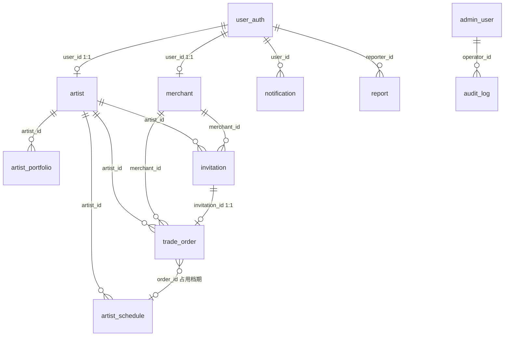

# 数据模型 ER 图（E2-01 归档）

- 来源：`server/prisma/schema.prisma`（迁移 `20261118024600_init_e2`）
- 库：MySQL 5.7 / `utf8mb4`；模型与字段为 camelCase，落库统一 snake_case
- 状态字段统一 `VARCHAR(16)` + 注释约定取值，校验交由 zod（避免 ENUM 迭代频繁迁移）

## 1. 关系总览



## 2. 表清单（15 张）

| # | 表名 | 说明 | 关键约束 |
|---|---|---|---|
| 1 | `user_auth` | 微信用户与登录态（M/B 共用） | `openid` UNIQUE；`phone_cipher` 密文 |
| 2 | `artist` | 化妆师入驻资料 | `user_id` UNIQUE；索引 `(status, city)`；`id_card_cipher` 密文 |
| 3 | `artist_portfolio` | 作品（图/视频） | 索引 `(artist_id, sort)`；`onDelete: Cascade` |
| 4 | `artist_schedule` | 档期 | UNIQUE `uniq_artist_date (artist_id, date)`；索引 `(date, state)` |
| 5 | `merchant` | 商家入驻资料 | `user_id` UNIQUE；索引 `(status)`；`license_cipher` 密文 |
| 6 | `invitation` | 商家邀约 | 索引 `(artist_id, status)`、`(merchant_id, status)` |
| 7 | `trade_order` | 订单状态机（避开保留字 `order`） | `invitation_id` UNIQUE；索引 `(status)`、`(artist_id, status)`、`(merchant_id, status)` |
| 8 | `audit_log` | 审核操作流水 | 索引 `(target_type, target_id)`；`operator_id` → `admin_user` |
| 9 | `admin_user` | 后台账号 | `username` UNIQUE；`password_hash` bcrypt；`fail_count` / `locked_until` 锁定用 |
| 10 | `notification` | 订阅消息发送记录 | 索引 `(user_id, created_at)`；`onDelete: Cascade` |
| 11 | `report` | 举报 | UNIQUE `uniq_reporter_target_date (reporter_id, target_type, target_id, date)`；索引 `(status)` |
| 12 | `event_log` | 埋点事件（漏斗/看板数据源） | 索引 `(event, created_at)` |
| 13 | `stats_daily` | 每日汇总指标 | `date` UNIQUE |
| 14 | `file_object` | 对象存储文件记录（私有桶） | `object_key` UNIQUE `VARCHAR(180)`（MySQL 5.7 767B 索引上限）；索引 `(user_id, created_at)` |
| 15 | `dict_item` | 字典（风格/城市/服务类型/商家类型） | UNIQUE `(type, code)`；索引 `(type, sort)` |

## 3. 状态字段取值约定

| 表 | 字段 | 取值 |
|---|---|---|
| `user_auth` | `role` | `artist` / `merchant` / NULL |
| `user_auth` | `status` | `active` / `disabled` |
| `artist` / `merchant` | `status` | `pending` / `approved` / `rejected` / `disabled` |
| `artist_portfolio` | `status` | `pending` / `online` / `offline` / `rejected` |
| `artist_schedule` | `state` | `available` / `booked` / `rest` |
| `invitation` | `status` | `pending` / `accepted` / `declined` / `expired` / `cancelled` |
| `trade_order` | `status` | `pending` / `accepted` / `in_service` / `finished` / `cancelled` |
| `notification` | `status` | `pending` / `sent` / `failed` |
| `report` | `status` | `pending` / `handled` / `rejected` |
| `file_object` | `status` | `pending` / `uploaded` / `deleted` |
| `admin_user` | `role` | `super` / `admin` / `auditor` |

## 4. 迁移与校验

```bash
cd server
npx prisma migrate dev      # 生成并应用迁移
npx prisma db seed          # 幂等写入字典/演示账号
```
